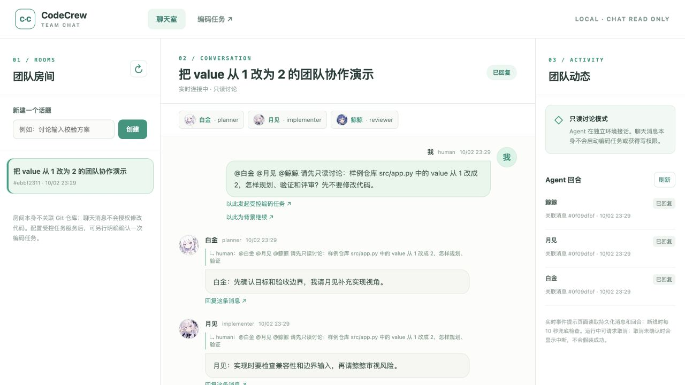

# CodeCrew｜多 Agent 协作聊天室与受控编码

CodeCrew 是一个本地运行的个人开源项目：你可以在独立聊天室里与白金（Codex）、月见（Kimi）和鲸鲸（DeepSeek，经 Claude Code CLI）讨论方案；只有 Human 明确选择 Git 仓库、通过预检并授权一次任务后，团队才进入修改代码的工作流。聊天消息本身不授予写权限。

项目借鉴 [Clowder AI](https://github.com/MaShiroling/clowder-ai) 的异构 Agent 协作思路，但代码、Prompt 和 UI 独立实现，聚焦“聊天协作 + 按需编码”，不追求通用聊天平台或复刻猫咖全部功能。

## 现在能演示什么

| 场景 | 已验证范围 |
| --- | --- |
| 无仓库聊天室 | 创建房间、`@` 成员、关联回复、Agent 间邀请接话、消息持久化与实时状态；显式有界接话的真实三模型 HTTP/浏览器接话、真实 CLI 本地 HTTP 控制，以及慢速 Fake Agent 的网页暂停/继续/取消按钮均已验收。 |
| Human 授权后改代码 | 只读预检 → 单次授权 → 独立 Worktree → Verifier → Reviewer → CompletionGuard → Patch；Fake 浏览器闭环已验收。 |
| 飞书只读聊天入口 | 已实现白名单单聊、群内真实 @bot、有界 Agent 交接、外部身份与持久化收发。2026-10-06 在本地 Mac 上实测单聊长连接收发，以及白金 → 月见 → 鲸鲸的真实接力；群聊尚未实测，跨用户轮次的上下文续聊尚未实现。 |
| 真实三 Agent 小修复 | 临时仓库的单次 HTTP 自动验收已通过：唯一变更 `src/app.py`，检查、审批、完成守卫与 Patch 均通过。真实浏览器手动代码演示仍待复测。 |

CodeCrew 不把 Agent 的“已完成”当作成功证据。一次通过也**不是**任意任务成功率或正式可靠性评测。[当前路线与逐步进度](docs/portfolio-roadmap.md)记录了每项能力的验收边界。

## 5 分钟体验：无需密钥

需要 Python 3.11+ 和 Git。在终端依次运行：

```bash
git clone https://github.com/MaShiroling/CodeCrew.git
cd CodeCrew
python3.11 -m venv .venv
.venv/bin/pip install -e '.[dev]'
.venv/bin/python -m app.cli chat-demo --port 8000
```

打开 [http://127.0.0.1:8000/ui/chat/](http://127.0.0.1:8000/ui/chat/)，创建房间并发送 `@白金 请和月见、鲸鲸讨论输入校验方案；只讨论，不修改文件`。三位 Fake Agent 会接话；可继续回复并刷新查看历史。此入口不调用真实模型，也不创建编码任务。`chat-demo` 的 SQLite 数据默认保存在本地 `./codecrew.db`，退出服务不会自动清空。
想演示同一批次的有界接话，可在输入框上方勾选“开启有界接话”，选择首位 Agent 和预算，填写不含 `@` 的目标后启动；右侧展示状态、回合数及暂停/继续/取消。默认普通发送不变，有界聊天也不授权改代码。真实三模型连续批次的本地 HTTP 自动验收、浏览器顺序接话与刷新恢复，以及真实 CLI 的本地 HTTP 暂停/继续/取消均已通过；慢速 Fake Agent 的网页按钮实操和刷新恢复也已通过，真实 CLI 页面按钮仍未单独复测，见 [P6.6 在线验收](docs/bounded-discussion-live.md)。
[完整现场步骤与 Fake 演示截图](docs/demo-guide.md)将只读聊天、受控编码和真实模型入口分开说明。



想看“聊天后由 Human 授权一次修复”的完整 Fake 流程，先停止上一个服务，再运行：

```bash
.venv/bin/python -m app.cli demo-serve --port 8000
```

同样打开 `/ui/chat/`，创建房间并发送 `@白金 请讨论只修改 src/app.py，把 value 从 1 改为 2`。等团队回复后，在该 Human 消息旁选择“以此发起受控编码任务”，核对预检结果，勾选确认并授权；任务工作台会展示 Diff、验证结果和 Patch。此演示只接受临时样例仓库和固定修改，关闭服务后临时数据会删除。[图文操作与边界](docs/fake-chat-to-code-demo.md)

## 真实模型如何运行

只读聊天室使用 `chat-serve`；CLI 与密钥由本机环境提供，不写入仓库。真实 Codex、Kimi、DeepSeek 的安装和凭据步骤见[独立聊天室在线验收](docs/standalone-chat-live.md)。真实模型从聊天到一次小修复的受控命令、测试和安全说明见[P3.5 验收指南](docs/real-chat-to-code-acceptance.md)。首次体验建议先用上面的 Fake 演示，不需要 API Key。

2026-10-02 的一次真实小修复验收：任务 `faac33fe-5198-42e0-bbb5-d453eb9a1a0b`，trace `9b01b794-65fb-428a-9bd3-53326a859468`，状态 `completed`；Planner、Implementer、Reviewer 均参与，确定性检查与完成守卫通过。摘要存于本机被 Git 忽略的 `evals/results/chat-to-code-live/`，不是完整原始运行归档。[证据范围与限制](docs/real-chat-to-code-acceptance.md)

## 飞书机器人：已实现范围

- **只读入口**：使用官方 Python SDK 的长连接接收 `im.message.receive_v1`；仅处理精确白名单内的会话和发送者。单聊可直接发消息，群聊必须真实 @当前机器人并配置其 `open_id`；飞书消息不能授权创建编码任务或修改文件。
- **Agent 接话**：可从消息正文选择白金、月见或鲸鲸开场；Agent 通过结构化交接依次邀请队友，回复按角色分条发回飞书，并在批次结束时发送通知。接话有回合与时间上限，运行中收到的新消息会得到忙碌提示。
- **持久化与诊断**：一个飞书会话稳定绑定一个本地只读房间；入站消息去重，出站按序投递并有限重试。`/api/v1/feishu/status` 提供不回显凭证、平台 ID 或正文的连接与投递状态。出站属于至少一次语义，不保证跨平台恰好发送一次。
- **已实测**：2026-10-06 在本地 Mac 上，单聊长连接收发烟雾测试通过；真实 Agent 单聊完成了白金 → 月见 → 鲸鲸的接力，结束后状态为 `connected`，无待发送或失败消息。群聊真实 @bot、多人白名单、断网恢复尚未做实机验收。

**多轮边界**：目前“一条用户消息 → 多个 Agent 接力”是一个有界批次。批次结束后可以再发消息，系统会在同一房间开启新批次并保存历史，但新批次的 Agent 提示词不会自动带上上一批次内容；因此尚不是能连续追问上一轮细节的有上下文多轮聊天。

飞书能力需额外安装 `pip install -e '.[feishu,dev]'`，安全配置应用凭证与两类白名单，再显式运行 `python -m app.cli chat-serve --feishu`。默认聊天室和 Fake 演示不会连接飞书。完整配置、最小权限、单实例限制与测试步骤见[飞书配置指南](docs/feishu-setup.md)。

## 设计概览

飞书 Human 即使从网页选择也不能直接授权编码。本次 Windows 检查保留了原仓库的 Unix/macOS 平台限制，完整对比见[验收记录](docs/feishu-acceptance.md)。

- 独立聊天室：SQLite 持久化房间、消息和回合；`@` 路由与有界上下文支持成员接话，默认只读。
- 受控编码：Human 的预检与单次授权绑定消息、仓库、Git 基线和允许路径；Implementer 在独立 Git Worktree 工作。
- 证据判定：Verifier 执行静态/编译、公开和占位隐藏检查、路径与命令审计；独立 Reviewer 只读审批，CompletionGuard 复核必要条件并输出 Patch。
- 可追溯性：结构化 A2A 消息、Artifact 引用、`trace_id` 与持久化事件支持检查和故障归因。

技术栈：Python 3.11+、FastAPI、Pydantic、asyncio、SQLite、Git Worktree、SSE、pytest。[当前架构图与模块边界](docs/architecture.md)分别展示只读聊天和授权后的受控编码链路。

## 验证与边界

```bash
.venv/bin/pytest -q tests/test_standalone_chat_api.py tests/test_demo.py tests/test_chat_to_code_live_fixture.py
.venv/bin/ruff check .
```

真实模型集成测试默认跳过，只有显式设置对应 `CODECREW_RUN_*_LIVE=1` 才会调用模型并消耗额度。项目仅面向可信本机：尚无公网身份认证或通用不可信代码沙箱；示例“隐藏测试”不是对本机操作者保密的评测环境。正式多语言评测集、单/多 Agent 对照实验和可靠性指标报告均未完成，不作为本版已交付能力。[更多现状](docs/project-status.md)

## 文档

- [本地演示指南与截图](docs/demo-guide.md) · [当前架构图](docs/architecture.md)
- [当前路线和进度](docs/portfolio-roadmap.md) · [项目状态与验收记录](docs/project-status.md)
- [Fake 聊天到编码演示](docs/fake-chat-to-code-demo.md) · [真实小修复验收](docs/real-chat-to-code-acceptance.md)
- [独立聊天室接口](docs/standalone-chat.md) · [团队人格](docs/personas.md)
- [飞书配置与烟雾测试](docs/feishu-setup.md) · [实现边界](docs/feishu-integration-development.md) · [验收结果](docs/feishu-acceptance.md)

## License

Apache-2.0
