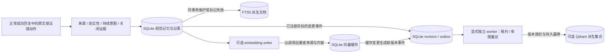
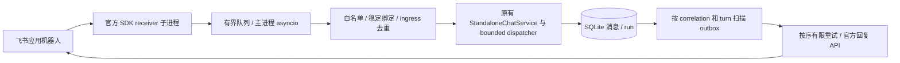
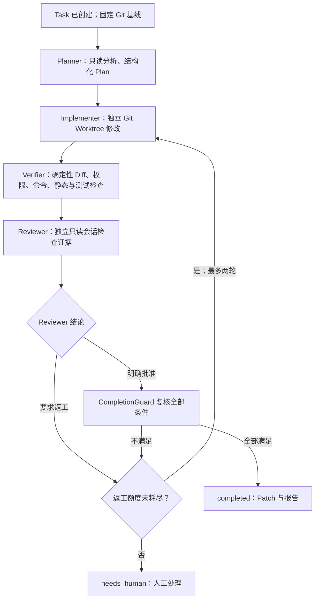

# CodeCrew 当前架构

更新于 2026-10-13（同步 FTS5/BM25、Qdrant、后台同步及真实持久目标验收；其他入口的逐次验收见各自记录）。当前产品有两条独立入口：**无 Git 仓库的只读聊天室**，以及
**Human 显式授权后才启动的受控编码任务**。下图描述已实现的本地单进程路径，
可选向量同步 worker 另由独立 CLI 进程显式运行；不是分布式 Agent 派发、远程 SaaS
或通用 Agent 平台的设计承诺。

## 系统边界

```mermaid
flowchart TB
    Human[Human] --> UI[浏览器 /ui/chat/]

    subgraph Chat[独立聊天室：默认只读]
        API[Chat API 与 SSE 通知] --> Service[StandaloneChatService]
        Service --> Store[(SQLite：房间、消息、回合)]
        API -->|普通消息| Dispatcher[StandaloneChatDispatcher]
        API -->|显式有界批次| Bounded[BoundedDiscussionDispatcher]
        Dispatcher --> Runtime[独立只读 Agent 会话]
        Bounded --> Runtime
        Bounded --> Store
        Store --> Memory[房间记忆：来源守卫 / 纠正 / 待办状态]
        Memory --> Recall[词项或 BM25；可选向量与 RRF]
        Recall --> Dispatcher
        Recall --> Bounded
        Runtime --> CLIs[Codex / Kimi / Claude 接 DeepSeek；或 Fake]
        Store --> API
    end

    UI -->|普通消息、@提及、回复| API
    UI -->|勾选有界模式；启动/暂停/继续/取消| API
    UI -->|Human 单独预检并确认| Auth[ChatCodingAuthorizationService]
    Auth -->|核对同房间 Human 消息| Store
    Auth -->|重查 Git 基线与写入范围；单次授权| TaskService[TaskService]
    TaskService --> TaskFlow[受控编码工作流]
```

普通聊天只保存消息并调度只读接话，不需要仓库路径，也不创建 Task/Worktree。
`@月见` 或 Agent 间 `handoff_to` 都**不是写权限**。聊天室 Agent 各用独立会话；
调度器传有界同讨论消息、显式选取的背景和同房间最多 3 条长期记忆，不复制完整聊天历史。SQLite 保存
消息、投递和回合状态；SSE 只提示页面重新读取持久化快照，不是逐 Token 输出。
有界批次另以 SQLite 记录 FIFO 邀请、预算和人工控制状态；暂停在安全回合边界
生效，继续保留原预算，取消不能确认时保守中断。P6.5 已在独立聊天室提供
默认关闭的网页入口和状态控件；P6.6 本地 HTTP 三模型连续接话自动验收已通过，
真实浏览器顺序接话与刷新恢复也已复核；真实 CLI 的暂停/继续/取消已通过
本地 HTTP 实操，慢速 Fake Agent 的网页按钮点击和刷新恢复也已通过。
真实 CLI 页面按钮未单独复测。

跨边界时，[预检](chat-to-code-authorization.md)先确认消息来自 Human、仓库和
Git HEAD 合法、路径范围可用；**预检不执行任务**。Human 勾选确认并提交
幂等键后，服务端再次检查基线和权限策略，再占用一次性授权记录并创建 Task。
未知结果的 `pending` 占用不会自动重派。只有显式装配了任务运行时的本地服务
才提供这条入口；`chat-demo` 和 `chat-serve` 不提供编码授权。

## 房间记忆边界

原始消息、有界历史和长期记忆分层。Agent 可在正常成功回复中附一条当前本地
Human 原文提议，服务端检查来源、片段、归属和敏感词后自动写入，无需人工审核。
SQLite 保存规范记忆与沿革；纠正原子退休旧版，待办完成/取消保留证据且退出
活跃召回。偏好额外校验持续意图，避免把一次性回答要求保存成长期偏好。
已关闭待办的明确状态询问能唯一匹配时，在启动 Agent 前由 SQLite 直接答复，
不调用模型/embedding；关闭记录不因此进入普通长期召回。这些规则仍不是通用语义证明。

### 数据归属与派生同步

SQLite 是事实来源；FTS、向量缓存和 Qdrant 都不是第二套可独立裁决事实的记忆。



规范变化与本机 outbox 事件在 SQLite 事务中共同提交；云 embedding 和远端投递
不在该事务内。worker 只消费已有匹配缓存或墓碑，不替 writer 调模型；缺缓存需要
writer 显式补齐。失败可能暂时损失语义命中，但不回滚已保存的规范事实。
租约/token 防止过期 owner 改写投递回执，远端 revision 防止迟到写覆盖较新版本，
退休保留墓碑防止旧活跃向量复活。语义是至少一次投递，不是双库原子或 exactly-once。

### 读取链路与后端选择

1. 在本机快照内选择同房间 active 候选、排除当前来源讨论，最多200条；每次输出最多3条。
2. 本地默认 `legacy`（ASCII词与中文双字片段），可选 FTS5/BM25。FTS文档是版本化
   预分词投影，脏/不可用时降级旧词项；不是把中文原文直接交给默认分词器。
3. 可选云查询 embedding：默认向量接线是SQLite缓存与进程内精确余弦；可选Qdrant
   接线只在规范候选和匹配缓存内做exact搜索，核对模型、维度、来源、内容hash及revision。
   Qdrant读路径不自动创建集合、投递积压或回填缺失文档向量。
4. 语义门槛0.65后按RRF `1/(60+rank)`融合各分支排名，再次核对规范状态。
   云端/远端失败时退回本地分支；无ANN、reranker或查询向量缓存。

代码默认是 `legacy + sqlite`、embedding off、worker disabled；显式配置才开启可选
路径，不能把代码默认等同本机已有进程实际加载的配置。[独立真实验收目标](memory-live-acceptance.md)
已使用BM25＋Qdrant＋百炼实际embedding与单Kimi回合，但没有迁移旧聊天库、切全局
默认或启用常驻服务。同步worker不会因聊天服务启动而自动运行。

没有全量聊天摘要、跨房间共享、主动提醒或自动语义冲突解决。飞书讨论不读写本地记忆。
流程、配置和证据分层见[交付总览](memory-v1-delivery.md)。
聊天成功、自动记忆保存和远端同步是不同提交点，当前没有持久自动提议补跑队列。

## 飞书只读入口

飞书是独立聊天室的可选入口，只有 `chat-serve --feishu` 显式装配：



接收子进程只收事件；每次 HTTP 发送另用可终止子进程，均不调度模型或访问数据库。父服务保持单实例；SDK 子进程用于确保阻塞收发可停止，不提供分布式调度。外部 Human 来源是可选消息字段，UI 和有界上下文区分真实发言者，preflight/authorize 拒绝外部来源。外部消息不能创建 Task/Worktree。SQLite migration 19 保存绑定、ingress、事件别名和 outbox；重启只补投递，不补跑不确定模型。真实飞书烟雾测试未执行；[实现细节](feishu-integration-development.md)说明 ACK、重复投递和有限重试的边界。

## 授权后的编码状态流



任务级 [TeamRoom](team-rooms.md) 持久化结构化 Agent 消息、ACK、Plan 版本与
证据引用。[WorkflowController](../app/team/controller.py) 把消息事件归约为合法
状态迁移和下一步指令；执行器再唤醒角色、运行 Verifier 或 CompletionGuard。
Planner、Implementer、Reviewer 使用彼此独立的会话。实现只在 Task 专属
Worktree 中进行；Worktree 在建 Task 时按确认的 Git 基线创建。Reviewer 只读，
不能修改代码或替代确定性验证。

Verifier 依据服务端配置运行静态/编译、公开测试、占位隐藏断言、变更目录与
命令审计；变更和结果形成 Artifact。CompletionGuard 同时要求有效 Diff、
必要检查通过、Reviewer 明确批准、没有未解决高优先级问题以及证据完整。
Agent 的自然语言“完成了”不会让 Task 进入 `completed`。当前示例的“隐藏测试”
对本机操作者不保密，不能当作正式评测隔离。

## 模块与数据归属

| 边界 | 主要实现 | 持久化或产出 |
| --- | --- | --- |
| 独立聊天 | [`app/chat/`](../app/chat/)、[`app/api/chats.py`](../app/api/chats.py) | SQLite 房间、消息、投递、回合；SSE 失效通知 |
| 规范记忆与生命周期 | [`app/chat/memory.py`](../app/chat/memory.py)、[`app/chat/dispatch.py`](../app/chat/dispatch.py) | SQLite 来源、活跃/退休状态、纠正沿革、待办关闭证据及状态回执 |
| 本地检索与云向量 | [`app/chat/fts_memory.py`](../app/chat/fts_memory.py)、[`app/chat/fts_text.py`](../app/chat/fts_text.py)、[`app/chat/vector_memory.py`](../app/chat/vector_memory.py) | 可重建FTS5/BM25投影、模型身份与向量缓存；词项/语义RRF |
| 远端派生同步与读取 | [`app/chat/vector_outbox.py`](../app/chat/vector_outbox.py)、[`app/chat/vector_worker.py`](../app/chat/vector_worker.py)、[`app/chat/qdrant_memory_index.py`](../app/chat/qdrant_memory_index.py)、[`app/chat/qdrant_vector_sync.py`](../app/chat/qdrant_vector_sync.py) | 至少一次投递、租约/revision/墓碑、规范范围复验；可选Qdrant，不替代SQLite事实 |
| 派生维护与一致性检查 | [`app/chat/vector_maintenance.py`](../app/chat/vector_maintenance.py)、[`evals/check_memory_persistent_restart.py`](../evals/check_memory_persistent_restart.py) | 显式回填/双向审计/修复；独立持久目标同库只读重开证据，不自动修库 |
| 授权桥接 | [`app/chat/coding_intent.py`](../app/chat/coding_intent.py)、[`app/chat/coding_authorization.py`](../app/chat/coding_authorization.py) | 预检快照、单次授权记录、Task ID |
| Agent 与任务控制 | [`app/agents/`](../app/agents/)、[`app/team/`](../app/team/)、[`app/orchestration/`](../app/orchestration/) | 独立会话、任务状态、TeamRoom 消息与返工轮次 |
| 隔离与判定 | [`app/workspace/`](../app/workspace/)、[`app/verification/`](../app/verification/) | Worktree、Patch、检查报告、完成决策 |
| 证据与追踪 | [`app/storage/`](../app/storage/)、[`app/trace/`](../app/trace/) | SQLite 快照/事件、内容寻址 Artifact、`trace_id` |

各角色通过 `AgentAdapter` 接口接入 CLI 或 Fake；结构化 A2A 消息只携带必要字段
和 Artifact 引用。Task 与运行上下文使用持久化快照及修订号，Trace 记录可关联
任务事件；这不是跨进程分布式调度保证。启动模式和已验证范围见
[README](../README.md)与[当前路线](portfolio-roadmap.md)。

## 验收范围与未完成项

- Fake 浏览器已走通“聊天 → Human 预检/授权 → 编码 → Patch”；真实三模型完成过
  **一次临时小修复的 HTTP 自动验收**，不等于任意任务成功率或浏览器手动代码演示。
- 独立聊天室真实三模型最小对话已验收；长聊背景引用只通过 Fake 与真实 Planner
  的限定场景。房间长期记忆现在由 Agent 从本地 Human 消息自动提议，服务端校验来源后写入，
  已通过离线与网页脚本测试，并完成单 Kimi 的小规模合成端到端回放和已见故障回归。
  24 条固定记忆配对 A/B 隔离比较了词项与混合召回；延迟/API 用量另有基准。
  Fake 浏览器主旅程的写入、召回、来源、完成/取消、撤销与同库重启已实操并留档。
  FTS升级、可选Qdrant接线及显式后台同步均已有分阶段证据；[独立真实持久目标](memory-live-acceptance.md)
  的五项已按前序运行＋恢复＋两条补验＋两个新进程同库重开收尾。重开时1条有效
  决定可召回、4条退休记忆不复活，远端5条current含4墓碑、积压0。
  这不是新12条全通过、容器重启或联合灾备恢复；原失败报告和pending_human_review保留。
  这些不证明生产准确率、通用长期记忆或多 Agent 记忆质量；真实模型/云检索浏览器旅程未验收。
  详见[交付与证据总览](memory-v1-delivery.md)及[接口边界](chat-memory.md)。
- 当前仅建议可信本机运行；没有公网身份认证、通用不可信仓库 OS 级沙箱、
  对 Agent 真正保密的隐藏测试、正式评测集或多 worker 分布式派发。

逐次验收事实和后续步骤见[项目状态](project-status.md)。
