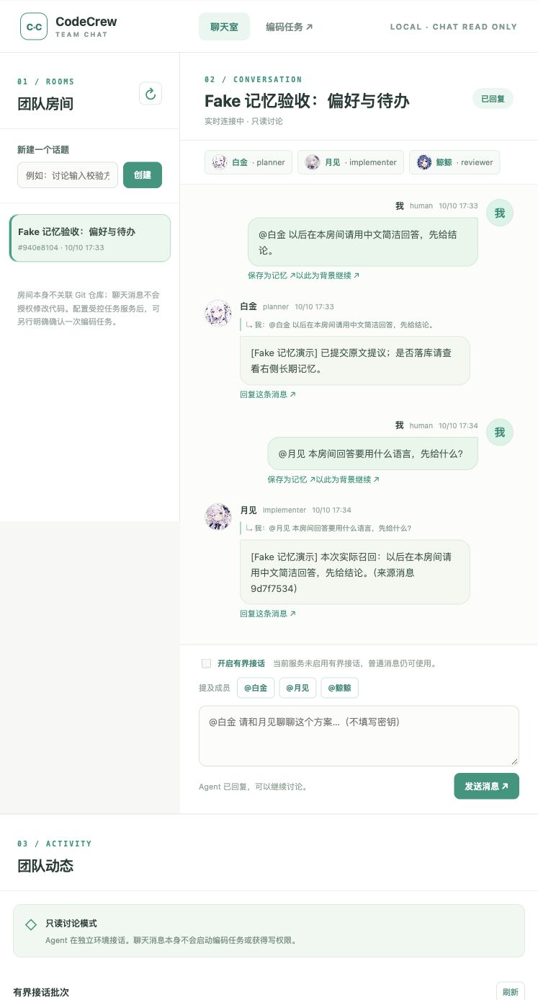
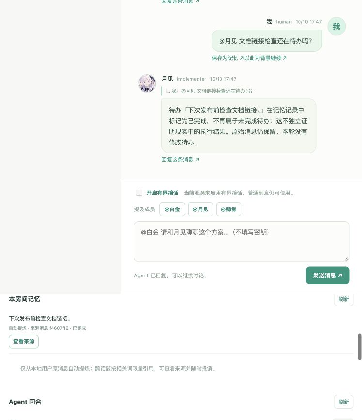
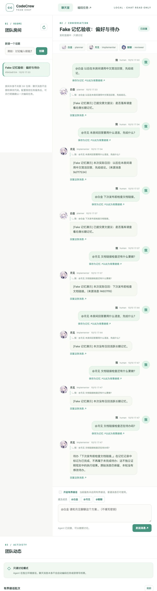
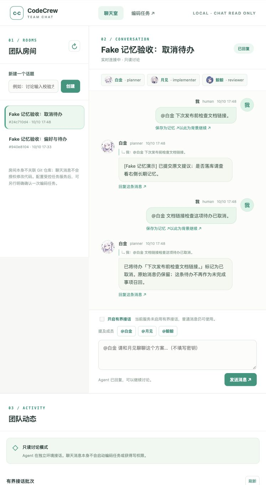
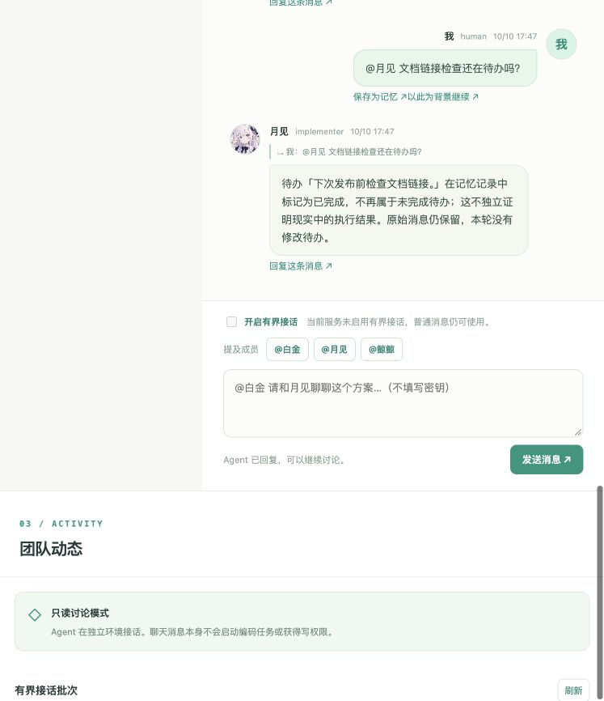

# 记忆模块浏览器旅程：Fake 验收与复现

2026-10-10，在本机 `127.0.0.1:8772` 的独立演示服务走通了自动写入、跨讨论召回、来源查看、网页完成/撤销、明确消息自动取消，以及刷新和重启检查。**Agent 为脚本化 Fake，embedding 关闭**；这里证明 UI、生产调度/记忆接口与持久化连通，不评价真实模型的提炼或语义检索质量。真实模型证据仍见[交付总览](memory-v1-delivery.md)。

## 独立无密钥入口

普通 `chat-demo` 的固定回复不会提出记忆，不能用它演示自动提炼。本次新增专用[演示脚本](../scripts/memory_browser_demo.py)，仅对下列固定合成原话提议偏好/待办；查询回复从生产调度实际传入的记忆中生成，不提前注入数据库，也不把预设答案冒充召回。其余消息不提议新记忆。

从项目根目录启动：

```bash
memory_demo_dir=$(mktemp -d /private/tmp/codecrew-memory-browser-XXXXXX)
.venv/bin/python -m scripts.memory_browser_demo --data-dir "$memory_demo_dir" --port 8772
```

打开 `http://127.0.0.1:8772/ui/chat/`。脚本只装配 Fake 普通聊天，不读取 `.env` 或创建真实 CLI/云客户端，不开放受控编码或飞书运行时。有界模式在 UI 中不可用；这是本轮选择的验收路径，不是产品功能退化。

数据目录必须是新的空私有目录，或由本脚本标记过的同一演示目录；不使用现有项目数据库，工作目录必须在 Git 仓库之外。停止后数据保留。重启时复用终端打印的**同一个目录**，不要再次执行 `mktemp`：

```bash
.venv/bin/python -m scripts.memory_browser_demo --data-dir "$memory_demo_dir" --port 8772
```

服务按[Uvicorn 官方程序化启动说明](https://github.com/kludex/uvicorn/blob/main/docs/deployment/index.md)使用单进程应用实例，不开启多 worker 或 reload，仅绑定本机回环地址。

若服务退出时等待 SSE 连接关闭，先让演示页离开或关闭该页，再等待服务正常退出；无需强制结束其他进程。

## 实际操作与判定

本轮只使用合成内容，两个新建房间均不绑定仓库：

| 步骤 | 浏览器操作 | 实际观察 |
| --- | --- | --- |
| 偏好自动写入 | `@白金 以后在本房间请用中文简洁回答，先给结论。` | 记忆卡片标为“自动提炼”，有来源消息；没有手动保存或审核。 |
| 跨讨论召回 | 直接新发 `@月见 本房间回答要用什么语言，先给什么？`，不选背景、不回复旧消息 | Fake 回显实际召回的完整偏好和来源短 ID；Human 两条消息的 `correlation_id` 不同，`reply_to` 都为空。 |
| 查看来源 | 点击偏好卡片“查看来源” | 当前焦点消息 ID 为原始 Human 消息 `9d7f7534…`，不是 Agent 回复。 |
| 待办自动写入/召回 | `@白金 下次发布前检查文档链接。`，再直接新发 `@月见 文档链接检查还有什么要做？` | 写入 `agent_auto/open_loop`；新讨论实际召回该待办，未误带偏好。 |
| 网页完成 | 点击卡片“标记完成”并确认 | 卡片显示“已完成”，不再提供完成/取消/撤销按钮，仍可查看来源；手动关闭没有虚构 Human 关闭消息 ID。 |
| 网页撤销 | 对偏好点击“撤销记忆”并确认，然后刷新并重新询问偏好 | 偏好卡片移除，原消息仍在，新的 Fake 回合没有召回活跃记忆。 |
| 重启恢复 | 正常停止进程，用同一目录启动；重新打开原房间，再问待办有什么要做 | 历史、来源与“已完成”卡片仍在；新回合没有活跃记忆召回。不是只刷新网页。 |
| 关闭状态问答 | 重启后发 `@月见 文档链接检查还在待办吗？` | 回复依据记录明确“已完成，不再属于未完成待办”，并说明不独立证明现实执行；这条服务端回执不调用 Fake 或云模型。 |
| 自动取消及依据 | 在第二个房间写入同一待办，再发 `@白金 文档链接检查这项待办已取消。` | 服务端接受 Fake 提议的取消动作；卡片“已取消”，关闭消息 ID 保留；“查看关闭依据”聚焦本次 Human 取消消息 `81ec7753…`。 |
| 取消后的刷新检查 | 刷新第二房间，重新询问待办有什么要做 | 已取消卡片保留，新的普通回合不召回该待办。第二房间取消后未再次重启服务，不将刷新称为重启证据。 |

完成/撤销的网页确认弹窗曾让浏览器控制工具报超时；用户明确批准后，重新读取页面并只读核对 SQLite，实际状态已更新。因此本轮是**有人确认的浏览器实操验收**，不是无人值守 UI 自动化，也没有绕过确认直接修改数据库。没有因控制工具超时就把产品动作判为失败或成功。

## 截图

截图只包含合成测试房间。采用当时内置浏览器的默认窄视口，“团队动态/本房间记忆”位于对话下方，并有独立滚动区域。对话长图不覆盖全部滚动面板，因此卡片另存可见区域截图，操作状态还结合页面读取与 SQLite 核对；没有调整视口或拼接内容。

1. 自动偏好与新讨论的实际召回：

   

2. 网页完成并重启后，状态回执与已完成卡片同屏；偏好已撤销，卡片保留查看来源：

   

3. 同一数据库重启后的对话长图：旧历史保留但普通回合不再召回，状态询问依据 SQLite 作答：

   

4. 明确 Human 消息自动取消后的服务端回执；关闭依据跳转另由页面焦点 ID 核对：

   

5. 重启后关闭状态回执的可见局部（不展示完整记忆列表）：

   

## 证据与复验

本机数据库保留于 `/private/tmp/codecrew-memory-browser-SOfQWd/chat.sqlite3`；这不是提交到仓库的运行归档，临时目录可能被系统清理。房间 `940e8104…` 完成/撤销旅程与房间 `24c710d4…` 取消旅程合计 20 条消息。结束时只读检查：

| 来源消息 | 类型 | 记忆状态 | 待办状态 | 关闭依据 |
| --- | --- | --- | --- | --- |
| `9d7f7534…` | preference | retired（撤销） | 不适用 | 不适用 |
| `f4607ff6…` | open_loop | retired | completed | 手动按钮操作，`closed_by_message_id=null` |
| `58fda1f1…` | open_loop | retired | cancelled | `81ec7753…` 本地 Human 消息 |

三条 `origin` 均为 `agent_auto`，活跃记忆总数为 0。偏好提问与来源分别属于 `ac7b9e65…`、`1229df4e…` 两个讨论；重启后的待办查询属于新讨论 `2afbc81b…`。网页写入与闭环均走原有 API/调度路径，没有用 SQL 插入、改状态或绕过守卫。

本次运行的核心代码 SHA-256：

```text
scripts/memory_browser_demo.py 8435f64a9049e1e75c88eeb4266c209cdbd30aadc0f441fc33cdd6ea41a9a636
app/chat/memory.py            9054de003a3a45bad8eb4e58d16bb6f652e6bda2d87f3e58adfcb637cbf23a15
app/chat/dispatch.py          7b5712b32f1560dbfa9231ff0656573da3419dada52716da04f73f4b52c56c40
app/chat/store.py             54ef60595b4b7649f010f3ad36592ba88fdb67536bc9006ce4fd74a21bf14e40
app/web/chat.js               19e8aff941171b77820181c3879fc056c43caeb25a74012b5013005fa11adea5
```

无付费回归命令：

```bash
.venv/bin/python -m pytest -o addopts='' -q tests/test_memory_browser_demo.py tests/test_chat_memory.py tests/test_vector_memory.py tests/test_memory_open_loop_journey.py tests/test_standalone_chat_dispatch.py
node --test tests/ui_chat.test.cjs
.venv/bin/ruff check scripts/memory_browser_demo.py tests/test_memory_browser_demo.py
```

演示夹具额外验证继承了错误云配置也不启动 embedding、拒绝混入非空用户数据目录、完成/取消和撤销后重建服务不复活，以及关闭状态问答不调用 Fake。结果仅覆盖本次定向测试，不是全仓测试全绿。未增加真实模型或 embedding 请求，也未修改生产检索阈值、金标准或历史评测成绩。

本轮上述 Python 定向回归 **92 passed**；前端 Node 测试与 Ruff 通过。Python 输出有两条既有依赖弃用警告，不作为功能失败。新增夹具测试最初误把撤销接口的 HTTP 状态写为 204，已按现有 200 + retired 返回契约修正测试，没有改生产接口。

## 剩余边界

本轮没有实操手动取消按钮、纠正沿革 UI、外部来源隔离、多 Agent 有界批次或真实云检索的浏览器旅程；这些不能由本次截图推断通过。完成/撤销后不活跃召回不等于从消息历史抹除事实，Human 仍可显式引用旧消息。Fake 只回显长期召回，不模拟真实模型如何同时理解旧历史。