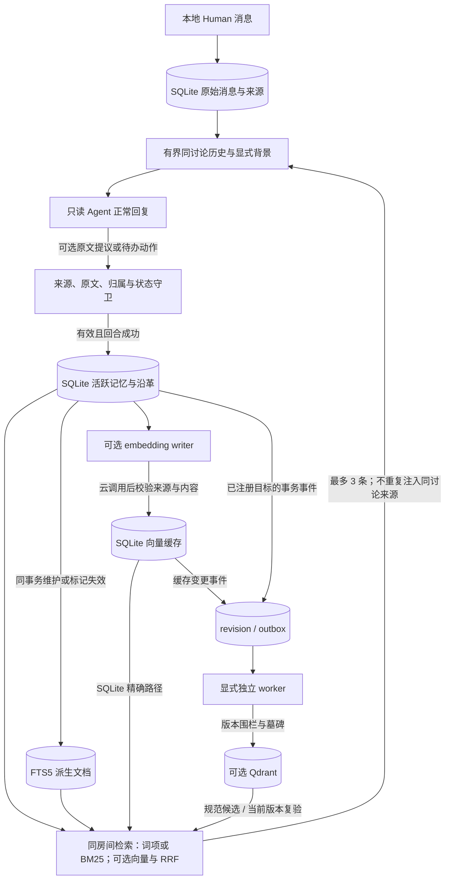

# CodeCrew 记忆模块 v1：交付与证据总览

更新于 2026-10-13（同步 FTS5/BM25、Qdrant、显式后台同步及独立真实持久目标收尾，默认仍为旧路径）。本页统一说明**当前实现、已有证据和未验证边界**；接口与配置见[技术说明](chat-memory.md)，逐次实验保留在各报告中，不用修复后的回归成绩覆盖原始结果。

当前结论：本地聊天室的记忆写入、检索、纠正和待办闭环已实现，单 Kimi Agent 的真实回放及已见故障修复已完成；可以在可信本机使用和演示。[Fake 浏览器主旅程](memory-browser-acceptance.md)也已完成，包括来源查看、完成/取消、撤销及重启检查。它不是生产级通用记忆系统，也没有证明任意长对话、多 Agent 或真实用户分布下的准确率；真实模型/云检索的独立浏览器旅程尚未验收。

后续FTS升级6/6、Qdrant接入7/7、读优化5/5和显式后台同步5/5均已实现并分阶段
留档。[独立真实持久目标五项](memory-live-acceptance.md)又按前序回合＋单条恢复＋
两条补验＋两个新进程同库重开收尾；不是新12条一次全通过。专属目标运行过
BM25/Qdrant和真实embedding/Kimi，全局默认、旧聊天库和在用Fake服务没有自动切换。
代码默认embedding off不等同本机私有配置或已有进程的实际开启状态。

## 1. 记忆如何进入一次回复



这里有三层不同的数据：原始消息是证据；有限历史是当前讨论上下文；长期记忆是从 Human 发言中选出的跨讨论资料。向量只是记忆的派生索引，不是新的事实来源。新讨论不会自动回放全部旧消息，也没有全量历史摘要或无限上下文机制。

记忆不授予改代码的权限。飞书等外部来源讨论既不能创建，也不能读取本地长期记忆；房间之间不共享记忆。

## 2. 已实现能力

| 能力 | 当前行为与边界 |
| --- | --- |
| 自动写入 | Agent 在正常回复中可提议一条 `decision / correction / preference / open_loop`，无需单独提炼调用或人工审核；仅在回合成功后尝试保存。 |
| 来源忠实性 | 自动提议必须是当前本地 Human 消息中不超过 200 字的连续原文；保守检查分句、否定、条件、第三方归属和明显敏感信息。规则可能误拦或漏拦，不是完整语义验证或 DLP。 |
| 幂等与纠正 | 每个来源至多自动保存一条；合法同房间替换指向原子退休旧版，保留来源和沿革。没有通用语义去重或自动冲突解决。 |
| 手动管理 | 保存、查看来源/沿革、撤销；自动守卫不追溯改写既有记忆。 |
| 有界召回 | 每房间最多 200 条 active 记忆，每次最多召回 3 条，排除当前讨论来源；撤销、替换或关闭后不再进入活跃召回。 |
| 待办生命周期 | `open → completed / cancelled`；Human 可手动操作，Agent 自动动作须有当前 Human 的明确证据和唯一目标。疑问、条件、否定、歧义不自动关闭；没有主动提醒、到期或重开。 |
| 待办状态回执 | 已关闭待办的明确询问能唯一匹配时，在Agent启动前依据SQLite直接回答，不调用模型/embedding；关闭记录限最近50条。开启待办的部分状态文案仍在模型成功后覆写，不应把所有状态问答都称为零模型调用。记录状态不独立证明现实任务完成。 |
| 云检索容错 | embedding 默认关闭；开启后写入/检索会发送文本给服务商。失败、超时或维度异常可退回本地词项检索，不阻断规范记忆落库。 |
| 偏好持续意图 | 自动偏好须有可核对的个人习惯、未来/默认或房间要求；一次性回答要求不自动升级为长期偏好。规则不追溯清洗既有错误，仍非完整意图分类器。 |
| 可选外部向量接线 | Qdrant只保存派生向量和元数据；限定同房间active规范候选、模型/维度/来源/content hash/revision，并在远端查询后复验，不依赖ANN扩大候选。 |
| 持久投递与维护 | SQLite事务outbox、租约/token、有限重试/dead、revision墓碑、显式回填/双向audit/修复；独立watch不随聊天启动，不生成embedding。至少一次投递，非双库原子或exactly-once。 |

“工具尚未选定”不会单独作为待办写入；“还没决定，先比较两种方案”有明确行动，可写入。完整房间范围、否定和条件应保留，不能把 Agent 建议变成 Human 的决定。

## 3. 检索具体实现

- 默认本地分支仍为 ASCII 词项和中文双字片段匹配；可选 `bm25` 已接入 FTS5 查询、同房间过滤、状态/版本检查与故障降级。两者都可与向量按 RRF 融合；[新四分支 A/B](memory-fts-ab.md)中两关键词均召回 10/12、两真实混合均 12/12，全部无误召回且无网复跑一致。BM25 相对旧关键词无增量收益证据，不切默认。
- 语义分支：可配置的 HTTPS OpenAI 兼容 `/embeddings` 接口；已联调百炼 `text-embedding-v4`。生产默认相似度门槛为 `0.65`，并非已证明最优。
- 存储与计算：SQLite保存规范事实、浮点缓存、内容指纹、模型身份和维度；默认进程内精确余弦。[可选Qdrant](memory-qdrant-recall.md)消费同库版本化outbox目标，仍在最多200条规范候选内exact查询，不使用ANN或SQLite向量扩展。两种接线在已见配对样本中有序来源一致，不据此声称外部库有独有质量收益。
- 混合排序：词项和语义各自排序，用 RRF（常数 60）融合；语义独有候选可进入结果。没有额外 reranker。
- 索引维护：通常由writer在规范落库后构建缓存。SQLite原路径查询按需补建，每次最多10条；Qdrant读路径只用匹配缓存、不在查询中回填，缺缓存由writer显式补齐，再由独立worker投递。模型URL/名称/手动`REVISION`和维度标识索引；换模型需明确目标及维护，不混用维度、不自动热切换。
- 当前没有查询向量缓存；已建索引的云召回仍需对查询调用 embedding。手动版本标签也不保证供应商实际后端版本被固定。

规范变化与outbox事件在本机同事务提交，embedding/远端网络不在该事务内。退休
清除本地派生cache/FTS并推进revision，远端保留墓碑而非物理删点；迟到旧写不能
覆盖新状态。服务端规范候选限制/复验和本地降级负责读取边界，双向audit另负责
定位缺失、漂移或孤儿。未同步仍可能损失语义召回，不承诺瞬时双库一致或任意故障自愈。

实现入口：[规范记忆与守卫](../app/chat/memory.py)、[派生向量与云客户端](../app/chat/vector_memory.py)、[上下文与正常回合写入](../app/chat/dispatch.py)、[有界调度](../app/chat/bounded_dispatch.py)。两个调度入口共享存储/检索能力，但现有真实质量评测针对**普通聊天路径、单 Kimi Agent**，不代表多 Agent 有界批次也获得同等质量验证。

## 4. 已有评测：不能混用的几类证据

下表 TP/FP/FN 按**来源 ID**计算，不是用例通过数；它们不自动判断全文忠实性、分类或最终回复是否正确。题目为合成场景，24 条挑战集和 12 条泛化集的金标准由 Agent 起草后由用户确认；真实回复主要是 Agent 语义初审，原始记录的 `pending_human_review` 不改成已通过。

| 实验 | 条件与结果 | 能支持什么 |
| --- | --- | --- |
| [24 条配对检索 A/B](../evals/baselines/memory-retrieval-ab-v1-2026-10-10.md) | 同一标注记忆、查询与快照；无 Agent 调用。词项 TP/FP/FN = 10/0/2，混合 = 12/0/0；来源级 Recall@3 从 83.3% 到 100%，提高 16.7 个百分点。 | 隔离检索阶段，补回两个语义改写目标；只有 12 个应召回来源，不代表端到端或线上提升。 |
| [24 条 Kimi 端到端回放](../evals/baselines/memory-unseen-live-v1-2026-10-10.md) | 全部完成；写入 23/0/1，召回 12/0/0。包含 4 条已跑冒烟题和 20 条首次端到端题；检索题此前已用于 A/B。 | 自动写入→召回→回答链路可用；发现格式偏好漏写、已决事项与禁令表述问题，不是严格全流程盲测。 |
| [12 条新措辞泛化回放](../evals/baselines/memory-generalization-live-v1-2026-10-10.md) | 全部完成；写入 11/1/1，精确率/召回率均 91.67%；召回 5/1/1，Recall@3 为 83.33%。其中 4 条先跑过冒烟、8 条首次运行。 | 暴露房间归属误拦、未决状态误记待办和禁令首句错误；保留原始缺陷与分数。 |
| [最新三题修复回归](../evals/baselines/memory-generalization-regression-2026-10-10.md) | 写入 3/0/0，召回 2/0/0；三题回复核心要求经 Agent 初审满足。金标准与阈值未改。 | 已见故障修复闭环；不能改写原始 12 题指标，也不证明新代码已完整重跑 12 题。 |
| [两条真实待办旅程](../evals/baselines/kimi-open-loop-journey-2026-10-10.md) | 开发待办完成、个人待办取消，分别运行；自动写入、跨讨论召回、关闭、重启后活跃召回为空。不调用 embedding。 | 两种正例的持久化闭环；末步只检查上下文，新增 SQLite 状态问答另由离线测试覆盖，非真实浏览器验收。 |
| [Fake 浏览器主旅程](memory-browser-acceptance.md) | 页面自动写入、跨讨论召回、来源/关闭依据跳转、完成/取消与撤销，刷新和同库重启；截图与只读 SQLite 核查留档。 | 有人确认的 UI/持久化链路验收，新增状态回执已实操；不调用真实模型/embedding，不评价提炼质量。 |
| [独立真实持久目标收尾](../evals/baselines/memory-persistent-restart-v1-2026-10-13.md) | 前序回合、单条误写恢复、两条真实补验、两个新PID同库重开；重开时1活跃/4退休、远端5条current含4墓碑、积压0。补验新增Kimi启动1/embedding API0，重开0/0。 | 规范来源、生命周期和派生同步的组合证据；不是新12条全通过、完整盲测、容器重启或联合灾备恢复。向量重开检查为既有文档缓存自匹配，不测新查询语义；原pending_human_review保留。 |

早期 [20 条 pilot](../evals/baselines/kimi-memory-v1-2026-10-08.md)、[忠实性难例与回答质量评测](../evals/MEMORY_BASELINE.md)保留为调试历史。不能将不同代码、不同阈值或多轮挑选的结果拼成一个总准确率。“未见”是首次运行时的属性；题目被观察并用于修复后就是已见回归集。

## 5. 延迟与成本证据

独立[性能报告](../evals/baselines/memory-retrieval-latency-cost-2026-10-10.md)在同一批 24 条合成题上测检索，不调用 Agent：

| 路径 | 样本数 | p50 | p95 |
| --- | ---: | ---: | ---: |
| 本地词项召回 | 72 | 0.661 ms | 1.128 ms |
| 已建索引、实际调用云 embedding 的混合召回 | 42 | 372.627 ms | 719.494 ms |
| 缺少派生索引、首次读取并回填的云召回 | 14 | 788.360 ms | 1095.329 ms |

没有触发云调用的路径单独统计，没有混进云延迟。“冷读”指向量索引缺失，不是应用启动。以上是本机、小样本、无并发负载的阶段延迟，不是完整 Agent 回复延迟或生产 SLA。

正式性能基准记录 92 次 embedding 请求、96 段文本、API 返回 1,140 tokens。按该报告记录的当时公开原价估算为 ¥0.00057，**不是实际扣款或当前价格承诺**，不包含 Kimi、其他实验和优惠。用户已选择跳过实际账单核对，不再将其列为未完成项。

## 6. 无付费复验与证据位置

在项目根目录可运行以下命令；它们不调用真实 Agent 或云 embedding：

```bash
.venv/bin/python -m evals.validate_memory_baseline
.venv/bin/python -m evals.validate_memory_unseen
.venv/bin/python -m evals.validate_memory_generalization
.venv/bin/python evals/check_memory_fidelity.py
.venv/bin/python -m pytest -q tests/test_chat_memory.py tests/test_vector_memory.py tests/test_memory_open_loop_journey.py
```

题库和审核锁存入仓库；评测原始JSON、manifest和模型回复位于本机Git忽略的
`evals/results/`，真实持久目标/报告另在`.codecrew/memory-live-acceptance/`；各报告给出
具体目录。结果不是随仓库公开的完整原始归档；manifest记录题库/代码/配置指纹，
续跑只能复用兼容的完整前缀，不能把未完成回合计为质量失误。当前旧付费续跑与
恢复入口不可重复强制运行；同库只读重开及拒绝条件见[操作说明](memory-persistent-restart.md)。

配置步骤见[云端向量检索](chat-memory.md#可选的云端向量检索)，真实命令见 [24 条评测说明](../evals/MEMORY_UNSEEN_V1.md)和[12 条泛化说明](../evals/MEMORY_GENERALIZATION_V1.md)。`--live` / `--embed` 才显式调用对应服务；密钥只放本机私有配置或终端隐藏输入，不进入文档、命令参数或结果。收尾不需要反复付费重跑已经通过的故障题。

## 7. 当前限制与收尾状态

- 仅建议可信本机：没有公网身份认证、完整秘密检测或生产级多用户隔离承诺。
- 小规模合成评测、单 Kimi Agent，服务端模型版本未严格固定；没有独立第三方盲测、多 Agent 记忆质量对照或长期真实使用证据。
- 提议无效时不写入但不影响聊天；当前拒绝原因与遗漏提议的观测还不充分，不能只凭来源统计定位所有漏记。自由回复也不应当作可靠落库回执。
- 不提供跨房间全局记忆、自动语义去重/冲突解决、完整长对话压缩、主动提醒、自动过期或通用记忆迁移。
- 有离线/API/前端脚本证据和 Fake 浏览器主旅程；尚无真实模型/云检索的独立浏览器验收，手动取消与纠正沿革 UI 等也未由本轮覆盖。相关定向测试通过不等于全仓测试全部通过。

以下保留后续开发当时进度，1/7等数字不是当前状态。当前FTS、Qdrant、读优化、
后台同步及独立真实目标验收均已阶段收尾，最新证据见顶部链接；“默认不启用”不
等于“功能未实现”。各次测试集合不同，历史用例数不累加，相关通过不等于全仓全绿。

后续 [FTS5/BM25 检索升级](memory-fts-upgrade.md) **6/6 子步骤已完成**，含[真实四分支质量/延迟与缓存复跑](memory-fts-ab.md)。边界矩阵修复同名失效触发器的恢复缺口；扩大定向回归 **439 项通过**，不是全仓验收。BM25 无增量收益证据，不切换默认，不用新结果覆盖本页原始评测。用户确认后成功采集 34 次 embedding 请求（加沙箱失败共 35 次）、0 Agent；未改私有配置或操作真实用户数据库。该阶段当时外部向量数据库尚未接入。

随后[向量存储第二阶段](memory-vector-upgrade.md)完成 **1/7**：接口、范围/一致性契约与
SQLite 精确参考适配器（当时未接线）。新增 36 契约测试，扩大定向 475 项通过；真实缓存
四分支复跑有序来源不变、0 请求。当时外部库、可靠同步、回填和新召回尚未实现。

第 2/7 的 [Qdrant 存储适配器、可选配置、Compose 和真实服务探针](memory-qdrant-storage.md)
已开发并通过离线测试；用户选择本机 Docker。首次安装失败后用户手动安装/启动，
获授权启动 Qdrant 1.19.0，[真实合成向量存储探针](../evals/baselines/memory-qdrant-storage-v1-2026-10-11.md)
四组检查及自有集合清理通过，0 embedding/Agent；当前 **2/7 完成**。
仅完成存储层，聊天仍使用原 SQLite 编排，可靠同步/回填/召回接线未完成，不能宣称外部库已上线聊天。

第 3/7 的 [outbox 可靠同步](memory-vector-outbox.md)随后完成：事务内事件、有限重试/
死信、租约接管、远端版本/持久墓碑，新增 65 项测试、扩大定向 576 passed；
[真实合成旅程](../evals/baselines/memory-vector-sync-v1-2026-10-11.md)通过且测试集合已清理，
0 模型调用。当时第二阶段 **3/7**，没有迁移真实聊天库或切换默认；worker 需显式
运行，当时历史回填、生产调度/召回接线与完整性能/故障矩阵未完成。

第 4/7 的[历史维护工具](memory-vector-maintenance.md)随后完成：分批历史回填、事务内
checkpoint、并发 CAS、双向实际向量审计、高版本 outbox 修复、新 namespace 重建。
新增 66 项、扩大定向 642 passed；[真实合成旅程](../evals/baselines/memory-vector-maintenance-v1-2026-10-11.md)
通过，两自有集合已清理，0 模型调用。当时第二阶段 **4/7**；缺少匹配缓存仍等待，
不自动生成新模型向量或热切换。未操作真实聊天库、切默认、改私有配置或重启服务。
当时下一步为第 5/7 混合召回接线；自动调度、完整性能/故障矩阵仍需后续验证。

2026-10-12 第 5/7 [可选 Qdrant 混合召回](memory-qdrant-recall.md)已完成：CLI 构造选择、
当前版本/hash scoped 查询、RRF、规范/缓存复验及故障降级，默认仍原 SQLite。
新增 58 项、扩大定向 700 passed；[真实合成上下文探针](../evals/baselines/memory-qdrant-recall-v1-2026-10-12.md)
四组通过且集合已清理，0 真实 embedding/Agent，不动私有配置/业务库/在用服务。
此步完成时第二阶段 **5/7**。第 6/7 [实际故障/恢复矩阵](memory-qdrant-faults.md)
随后完成：专属容器六次停启、九组检查、最终审计一致，38 新增测试/738 扩大定向。
此步完成时 **6/7**，worker 仍显式运行。
人工合成向量验证不提高本页历史模型成绩。

2026-10-12 第 7/7 [质量/延迟/规模对照](memory-qdrant-benchmark.md)完成：24 条已见
回归复用真实百炼缓存，两混合 12/12、零 FP、有序来源和完整向量排名一致；四档
合成规模/真实 outbox 与 audit 通过。200 候选 SQLite/Qdrant 本地检索 p95
22.549/92.393 ms，不含云/Agent，不能当裸引擎性能结论。新增 45 项、扩大定向
783 passed；0 新模型、自有容器清理且证据保留、真实服务/私有配置/默认未动。
第二阶段 **7/7**，保留 SQLite/旧词项默认；不宣称 ANN、生产 SLA、自动 worker 或独立盲测。

随后[读优化](memory-qdrant-optimization.md)5/5、[显式后台同步](memory-vector-worker.md)5/5
完成，包含独立OS进程租约恢复和自动投递旅程，但没有自动启用用户worker。最后
[真实持久目标](memory-live-acceptance.md)五项组合收尾；原一次性要求误写和状态
判据缺陷留档，代码修复、历史数据恢复和真实补验分别证明，不提高历史泛化分数。
2026-10-13重开阶段相关933项回归通过（非全仓），只读重开新模型0/0；完整库快照
及原证据保持不变。当前能力、默认和证据边界应以本页顶部及[当前架构](architecture.md)为准。
